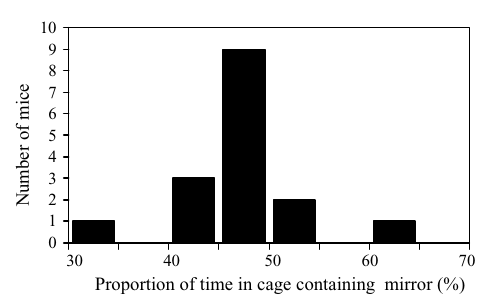

# this project containes jupyter notebooks with solutions to Yandex ShAD Week Intensive admittance qualification exam
## event: AI Analytics Week Школы анализа данных (YSDA) in Nov-Dec 2026
## notebooks (in project subfolder "notebooks") list:

### task A: Mirror for Algernon
Researchers studied whether the presence of a mirror is associated with laboratory mice's choice of where to spend their time.

16 laboratory mice were individually placed in cages consisting of two rooms connected by a tunnel. One of the rooms contained a mirror, while the other did not. During the experiment, the position of the mirror was changed to reduce the influence of room location on the results.

For each mouse, the proportion of time spent in the room with the mirror was determined. The distribution of the resulting values is shown in the histogram.

The horizontal axis shows the proportion of time spent in the room containing mirror, expressed as a percentage; the vertical axis shows the number of mice.

It is known that each mouse spent more time in one of the two rooms than in the other. Assume that the results for different mice are independent and that the probability of spending more time in the room without a mirror is the same for all mice.

Can we conclude at the $5%$ significance level that mice tend to spend more time in one of the two rooms - with or without a mirror?

Propose a statistical test based on the available data, calculate the exact two-sided $p-value$, and draw a conclusion at the significance level $\alpha=0.05$. When calculating the $p-value$, account for deviations from the expected result in both the greater and the lesser directions.

#### Output format
In the answer field, enter two numbers separated by a space:
* the $p-value$ of the statistical test;
* the number `1` if the null hypothesis is rejected at the significance level $\alpha=0.05$, or the number `0` otherwise.

The absolute error of the $p-value$ must not exceed $10^{-4}$.